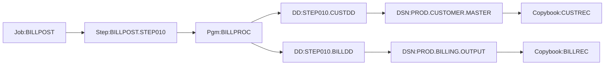

# build-mainframe-data-lineage — Worked Example

## Scenario

The billing-mainframe project has all three contributing RE passes complete. The KB at `~/code/billing-kb/` is populated:

- `~/code/billing-kb/source-docs/billing-copybook/copybook-library-consumer/copybook-record-graph.json` — 387 copybooks; 401 named variants
- `~/code/billing-kb/source-docs/billing-cobol/cobol-program-internal/{program-call-graph.mmd, program-data-bindings.json, program-exec-inventory.md}` — 142 programs; 312 static + 18 dynamic CALL edges; 73 SQL + 41 CICS + 4 DLI EXEC blocks
- `~/code/billing-kb/source-docs/billing-jcl/jcl-job-internal/{job-flow.mmd, dataset-io.json}` — 64 jobs; 219 step nodes; 12 GDG bases

User says: *"Build mainframe data lineage."*

## Step 1 — Validate Inputs

The skill reads `project.toml`, identifies the three contributing repos by role (`copybook-library`, `cobol-program`, `jcl-job`), and confirms the feed-files exist and parse:

```
project.toml [[project.repos]]:
  billing-copybook  role=copybook-library  ✓ copybook-record-graph.json (387 entries)
  billing-cobol     role=cobol-program     ✓ program-data-bindings.json (142 entries)
                                           ✓ program-exec-inventory.md (118 EXEC blocks total)
                                           ✓ program-call-graph.mmd (parses)
  billing-jcl       role=jcl-job           ✓ dataset-io.json (219 step entries)
                                           ✓ job-flow.mmd (parses)

GO.
```

## Step 2 — Build copybook-where-used

Joins copybook-record-graph entries with program-data-bindings.

```
CUSTREC (canonical record CUST-RECORD)
  Copied by 87 programs:
    BILLPROC      (FILE section, FD CUST-FILE)
    BILLPOST      (LINKAGE section, LK-CUST-RECORD)
    BILLREPT      (FILE section, FD INPUT-FILE)
    ...
  Used by 23 JCL steps writing PROD.CUSTOMER.* datasets

BILLAREA (variants BILLAREA-V1, BILLAREA-V2)
  Copied by 14 CICS programs:
    BILLINQ  (LINKAGE — V2 selected by BA-V2)
    BILLUPD  (LINKAGE — V2 selected by BA-V2)
    ...
  Used by 0 JCL steps (CICS COMMAREA, not file-bound)

(... 387 copybook entries total)
```

## Step 3 — Build field-where-used

Joins canonical fields from copybook-record-graph with program-section citations.

```
CUST-AMOUNT (CUSTREC.CUST-RECORD.CUST-AMOUNT — S9(9)V99 COMP-3)
  Read by:
    BILLPROC.2100-CALC      (line 142 — MOVE CUST-AMOUNT TO WS-WORK)
    BILLREPT.2200-PRINT     (line 87  — DISPLAY CUST-AMOUNT)
  Written by:
    BILLPOST.2300-UPDATE    (line 198 — MOVE WS-NEW-AMOUNT TO CUST-AMOUNT)
  Drift warning:
    Also exists in CUSTREC.LEGACY as 9(11)V99 DISPLAY (drift — see copybook-conflicts.md)
    Programs still using LEGACY: BILLEXTR-OLD (deprecated)

BILL-LINE-COUNT (BILLDETLS.BILL-DETAILS.BILL-LINE-COUNT — 9(4))
  Read by:
    BILLPROC.2400-WRITE-DETAILS (line 220)
    BILLREPT.2200-PRINT          (line 90)
  Controls OCCURS:
    BILLDETLS.BILL-LINES (0..999 DEPENDING ON BILL-LINE-COUNT)
```

## Step 4 — Build MOVE Chain

Traverses program-exec-inventory.md and FD/LINKAGE bindings to produce field-to-field edges.

`move-chain.json`:

```json
{
  "version": 1,
  "edges": [
    { "id": "MV-001",
      "src": {"program": "BILLPROC", "section": "2100-CALC",
              "field": "CUST-RECORD.CUST-AMOUNT", "copybook": "CUSTREC"},
      "verb": "MOVE",
      "dst": {"program": "BILLPROC", "section": "2100-CALC",
              "field": "WS-AMOUNT", "copybook": null},
      "source_lines": "BILLPROC.cbl:142-142" },
    { "id": "MV-002",
      "src": {"program": "BILLPROC", "section": "2200-CALL",
              "field": "WS-AMOUNT", "copybook": null},
      "verb": "CALL_USING",
      "dst": {"program": "BILLCALC", "section": "LINKAGE",
              "field": "LK-AMOUNT", "copybook": null},
      "source_lines": "BILLPROC.cbl:158-160" },
    { "id": "MV-003",
      "src": {"program": "BILLCALC", "section": "1000-COMPUTE",
              "field": "LK-RESULT-AMOUNT", "copybook": null},
      "verb": "MOVE",
      "dst": {"program": "BILLPROC", "section": "2100-CALC",
              "field": "WS-CALC.WS-AMOUNT", "copybook": null},
      "source_lines": "BILLCALC.cbl:88-88" }
  ]
}
```

`move-chain.md` renders the human-readable view.

## Step 5 — Build Job → Program → Dataset Chain

Joins dataset-io.json (per JCL) with program-data-bindings.json.

`job-program-dataset-chain.mmd` (excerpt):



## Step 6 — Build EXEC SQL / IMS / CICS Bindings

```
db2-host-variable-bindings.md (excerpt):
  BILLPROC.2100-CALC: SELECT TAX_RATE INTO :WS-TAX FROM TAX_TABLE
    :WS-TAX  → WORKING-STORAGE WS-TAX (PIC S9(5)V99 COMP-3)
    Bound DB2 column: TAX_TABLE.TAX_RATE (DECIMAL(7,2))
    Type compatibility: ✓

ims-segment-bindings.md (excerpt):
  BILLEXTR.2100-READ: GU SEGMENT(CUSTSEG) INTO(CUST-IO-AREA) USING PCB(CUST-PCB)
    CUSTSEG → IMS-CUSTSEG (canonical IMS- copybook)
    CUST-IO-AREA → IMS-CUSTSEG.CUST-RECORD
    PCB sensitivity: matches CUST-PCB index 1

cics-commarea-bindings.md (excerpt):
  BILLINQ → BILLUPD via EXEC CICS LINK
    COMMAREA: LSCOMM (BILLAREA, V2 by BA-VERSION)
    Caller LENGTH: 200 bytes
    Callee LINKAGE: 01 LK-COMMAREA COPY LSCOMM. (200 bytes)  ✓
```

## Step 7 — Emit Unbound and Flagged

```
unbound-and-flagged-items.md:

Unbound EXEC SQL host variables: 0
Unresolved EXEC DLI segments:    0
Dynamic CALL sites with candidates listed but not resolved: 18
  BILLPROC.2300-DISPATCH (CALL WS-DISPATCH-NAME)
    Candidates: BILLDISP01, BILLDISP02, BILLDISPER  (per WS-DISPATCH-NAME assignment sites)
  ...
Symbolic-DSN datasets (not auto-resolved): 4
  PROD.BILLING.POSTED.&LDATE (BILLPOST.STEP020.OUTPUT)
  ...
Programs not invoked from documented JCL: 7
  BILLCALC, BILLDISP01, BILLDISP02, BILLDISPER, BILLW01, BILLW02, BILLLOG
  (callable subprograms — invoked via CALL only)
Divergent-copybook consumers: 1
  BILLEXTR-OLD copies CUSTREC.LEGACY (drift) — see copybook-conflicts.md
Unresolved INCLUDE chains: 0
```

## Step 8 — Verify Coverage

```
Coverage rule checks:
  [✓] All 387 copybooks appear in copybook-where-used.md
  [✓] All 142 programs appear as nodes in job-program-dataset-chain.mmd or are flagged
  [✓] All 73 EXEC SQL blocks have host-vars resolved or flagged
  [✓] All 4 EXEC DLI blocks have segments resolved
  [✓] All 41 EXEC CICS LINK chains have COMMAREA byte sizes matched
  [✓] move-chain.json validates against schema
  [✓] All flags accounted for in unbound-and-flagged-items.md

Verdict: GO. No coverage failures.
```

## Outputs

```
~/code/billing-kb/lineage/mainframe/
├── 01-lineage-overview.md
├── 02-copybook-where-used.md
├── 03-field-where-used.md
├── 04-move-chain.md
├── 04-move-chain.json
├── 05-job-program-dataset-chain.md
├── 05-job-program-dataset-chain.mmd
├── 06-db2-host-variable-bindings.md
├── 07-ims-segment-bindings.md
├── 08-cics-commarea-bindings.md
├── 09-unbound-and-flagged-items.md
└── 10-lineage-summary.md

change-tracker.md updated with one row (Parts Affected: lineage).
```

## Hand-off

> "Mainframe data lineage built. Run `verify-knowledge-base-coverage` for the audit cycle, or `navigate-knowledge-base` to load lineage context for a feature task."
