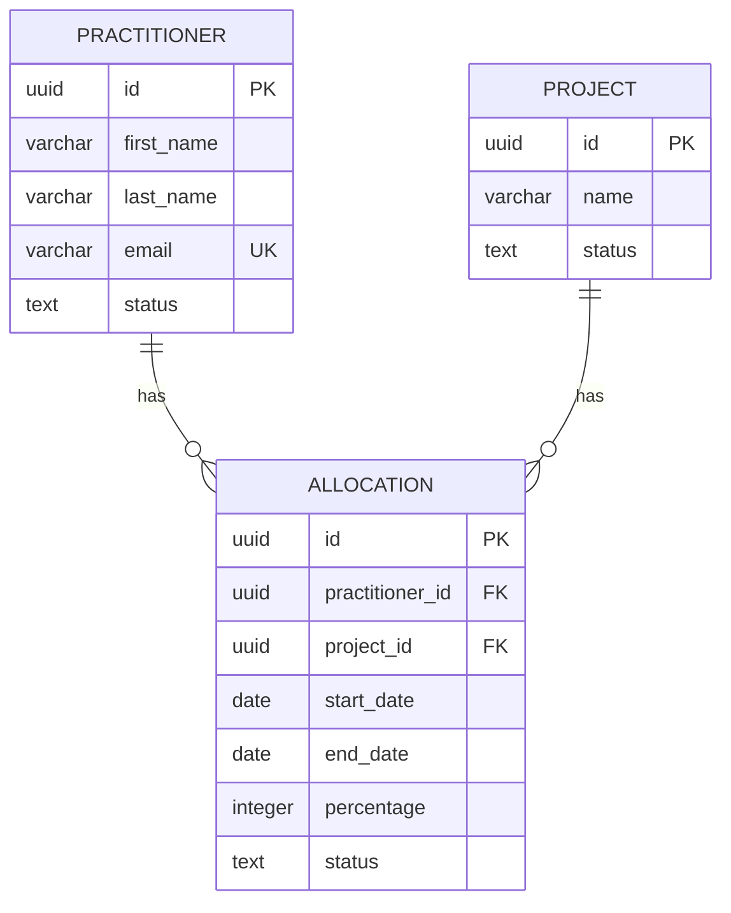

<!--
AUTHORING RULE — sub-section acknowledgement

Do not draft this entire block in one pass. The block contains multiple independent items (FRs / rules / endpoints / tables). For each item:

1. State the item heading and one-sentence scope.
2. Draft the item.
3. Present it to the user.
4. Ask: "Approve, change, or skip?"
5. Apply the answer; do not move to the next item until you have one.

Only after every item has its own acknowledgement, mark the block complete in the completeness tracker.
-->

## 7. Database Design

<!-- Technical design for the database layer. Translates data requirements from the Requirements Package into schema specifications. -->

### 7.1 Database Architecture Overview

- **RDBMS:** [e.g., PostgreSQL 16]
- **Hosting:** [e.g., Azure Database for PostgreSQL — Flexible Server]
- **Schema:** [e.g., public (single schema)]

### 7.2 Schema Design Conventions

<!-- Naming and structure conventions that apply to all tables. -->

| Convention | Rule | Example |
|-----------|------|---------|
| Table Names | [e.g., snake_case, singular] | [e.g., practitioner, allocation] |
| Column Names | [e.g., snake_case] | [e.g., first_name, created_at] |
| Primary Keys | [e.g., UUID, column name: id] | [e.g., id UUID DEFAULT gen_random_uuid()] |
| Foreign Keys | [e.g., referenced_table_id] | [e.g., practitioner_id UUID REFERENCES practitioner(id)] |
| Timestamps | [e.g., TIMESTAMPTZ, auto-populated] | [e.g., created_at, updated_at] |
| Status Fields | [e.g., TEXT with CHECK constraint] | [e.g., status TEXT CHECK (status IN ('ACTIVE', 'INACTIVE'))] |

### 7.3 Common Columns

<!-- Standard columns included in all or most tables. -->

| Column | Type | Description | Default |
|--------|------|------------|---------|
| [e.g., id] | [e.g., UUID] | [Primary key] | [e.g., gen_random_uuid()] |
| [e.g., created_at] | [e.g., TIMESTAMPTZ] | [Record creation timestamp] | [e.g., CURRENT_TIMESTAMP] |
| [e.g., updated_at] | [e.g., TIMESTAMPTZ] | [Last update timestamp] | [e.g., CURRENT_TIMESTAMP] |
| [e.g., created_by] | [e.g., UUID] | [User who created the record] | |
| [e.g., version] | [e.g., INTEGER] | [Optimistic locking version] | [e.g., 0] |

### 7.4 Core Tables

<!-- Define each table with its columns, constraints, and indexes. -->

#### [Table Name, e.g., practitioner]

**Purpose:** [e.g., Stores practitioner profiles]
**Implements:** [e.g., FR1.1]

| Column | Type | Nullable | Default | Constraints | Description |
|--------|------|:---:|---------|------------|-------------|
| [e.g., id] | [UUID] | No | [gen_random_uuid()] | [PK] | [Primary key] |
| [e.g., first_name] | [VARCHAR(100)] | No | | | [Legal first name] |
| [e.g., email] | [VARCHAR(255)] | No | | [UNIQUE] | [Corporate email, case-insensitive] |
| [e.g., status] | [TEXT] | No | ['ACTIVE'] | [CHECK IN ('ACTIVE','INACTIVE')] | [Record status] |
| | | | | | |

**Indexes:**

| Index Name | Columns | Type | Purpose |
|-----------|---------|------|---------|
| [e.g., idx_practitioner_email] | [e.g., LOWER(email)] | [e.g., UNIQUE] | [e.g., Case-insensitive email uniqueness] |
| | | | |

<!-- Repeat for each core table -->

### 7.5 Entity Relationship Diagram

<!-- Use Mermaid syntax for version-controllable ERD. -->

### 7.6 Migration Strategy

- **Tool:** [e.g., Flyway]
- **Naming Convention:** [e.g., V{version}__{description}.sql — e.g., V001__create_practitioner_table.sql]
- **Location:** [e.g., src/main/resources/db/migration/]
- **Rules:** [e.g., Migrations are append-only, never modify existing migrations]

### 7.7 Indexing Strategy

[Describe the overall indexing approach — what gets indexed and why.]

### 7.8 Data Retention & Archival

[Describe retention policies and archival approach.]
