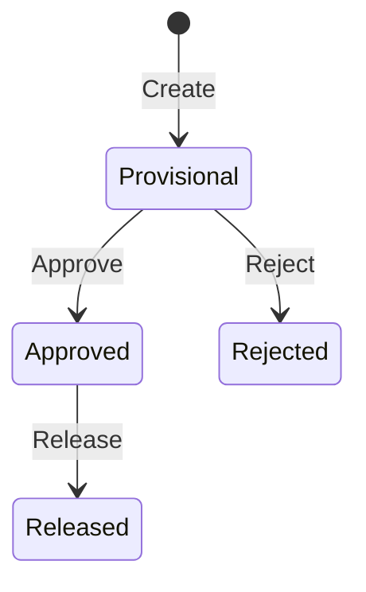

## 10. Workflow & Business Rules Design

<!-- How business rules from Requirements translate to system behavior. -->

### 10.1 State Machines

<!-- Technical implementation of state transitions from Requirements. -->

#### [Entity] State Machine

**Transition Rules:**

| From | To | Action | Required Role | Side Effects |
|------|-----|--------|--------------|-------------|
| [Provisional] | [Approved] | [Approve] | [Resource Manager] | [e.g., Notify requester, update availability] |
| | | | | |

### 10.2 Business Rule Implementation

<!-- Map business rules from Requirements to technical implementation. -->

| Rule (from Requirements) | Implementation Approach | Location |
|-------------------------|------------------------|----------|
| [e.g., BR1.1 — Allocation 1-100%] | [e.g., Bean Validation @Min(1) @Max(100)] | [e.g., CreateAllocationRequest DTO] |
| [e.g., BR1.2 — No duplicate allocations] | [e.g., Service layer check before save] | [e.g., AllocationService.create()] |
| | | |
