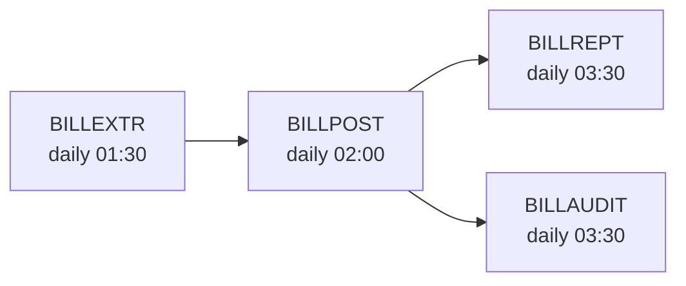

## 14. Predecessor and Successor Jobs

Per job, the upstream and downstream jobs in the daily / weekly run.

### 14.1 Per-Job Edge List

| Job | Predecessors | Successors | Source |
|---|---|---|---|
| [JOBNAME] | BILLEXTR | BILLREPT, BILLAUDIT | scheduler export YYYY-MM-DD |
| [JOBNAME] | (none — daily start) | NEXTJOB | scheduler-confirmed |
| [JOBNAME] | (multiple — see below) | (none — daily end) | derived from GDG / DD coupling |

### 14.2 Cross-Repo Edges

When a predecessor or successor job lives in a different repo (different RE pass), surface the cross-repo edge.

| Job | External Edge | Direction | Repo |
|---|---|---|---|
| [JOBNAME] | CUSTMNT-DAILY | predecessor | customer-mainframe |
| [JOBNAME] | REPORTING-EXTRACT | successor | reporting-mainframe |

### 14.3 Edge Confidence

Each edge is one of:

| Confidence | Definition |
|---|---|
| scheduler-confirmed | listed in the scheduler export supplied during RE |
| GDG-derived | inferred from GDG generation coupling (predecessor writes (+1); this job reads (0)) |
| DD-derived | inferred from DSN coupling (predecessor writes a DSN; this job reads it) |
| undocumented | scheduler export not supplied AND no GDG / DD coupling — flagged for follow-up |

### 14.4 Daily Run Order Diagram (excerpt)

### 14.5 Weekly / Monthly Edges

For non-daily jobs, document the calendar position and the connecting edges.

| Job | Frequency | Calendar Position | Edges |
|---|---|---|---|
| BILLARCH-WEEKLY | weekly | Saturday 22:00 | predecessor: last daily BILLREPT of the week |
| BILLREPT-MONTHLY | monthly | first business day 06:00 | predecessor: last daily BILLPOST of prior month |
